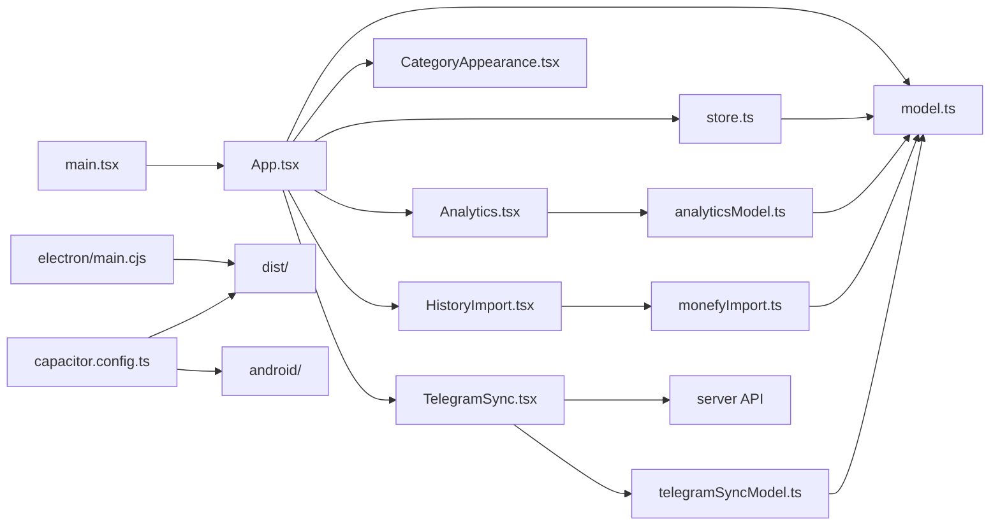

# MoneyStat agent guide

Use this file as the first orientation point. Read only the files relevant to the task; do not scan generated Android assets, `dist/`, `release/`, or `node_modules/` unless diagnosing build output.

## Product and invariants

- Local personal-finance diary for browser, Windows/Electron, and Android/Capacitor. UI language: Russian.
- Product behavior and acceptance rules: `docs/system-requirements.md` (authoritative). User-facing setup: `README.md`.
- Financial state remains local IndexedDB. There is no account system, telemetry, automatic exchange-rate feed, or full device sync. The optional `server/` stores only the Telegram catalog, wizard state, and pending queue; it never receives existing financial history.
- Money values are integer hundredths. Never use floats for stored money. Transfers are one `transfer` entry with `amount` (source) and `received` (target); they never count as income/expense.
- Preserve State v1 backup compatibility unless a task explicitly authorizes a migration. All persisted/restored state must pass `validate()`.
- Historical analytics use current rates. Display-currency conversion must not mutate entries.
- Import/restore replaces all data only after explicit confirmation. Reject ambiguous transfer pairs and invalid rows; never silently discard financial records.

## Project map

```text
src/
  main.tsx                React entry point
  App.tsx                 app shell, navigation, overview/accounts/settings, editors
  model.ts                State types, money math, balances, conversion, validation
  store.ts                Dexie IndexedDB load/change/restore transactions
  Analytics.tsx           analytics UI and comparative histogram
  analyticsModel.ts       pure expense aggregation/date-range logic
  analytics.css           analytics-only styles
  CategoryAppearance.tsx  category icon registry and visual picker
  HistoryImport.tsx       Monefy CSV preview + destructive replace flow
  monefyImport.ts         pure CSV parser/converter/validation
  TelegramSync.tsx        Telegram pairing, preview, pull/ack UI
  telegramSyncModel.ts    sync protocol client + idempotent local import
  style.css               shared/responsive application styles
tests/
  *.test.ts               Vitest model/import/analytics tests
  e2e/*.spec.ts           Playwright desktop + mobile workflows
electron/main.cjs          hardened Windows Electron shell
android/                   generated/native Capacitor Android project
scripts/convert-monefy.mjs offline Monefy CSV -> MoneyStat JSON converter
server/                    standalone Telegram webhook + PostgreSQL sync service
docs/system-requirements.md product/system requirements
docs/telegram-integration.md Telegram architecture, bot flow, deployment contract
docs/telegram-timeweb.md Timeweb Cloud VPS deployment/migration runbook
docs/VALIDATION.md         validation notes
capacitor.config.ts        Android bridge config (`dist` web assets)
package.json               commands, dependencies, packaging
```

## Dependency map



## Where to change things

- Money rules, State fields, validation: `src/model.ts`; add focused tests in `tests/model.test.ts`.
- Analytics calculations: `src/analyticsModel.ts`; UI in `src/Analytics.tsx`; tests in `tests/analytics.test.ts` and `tests/e2e/analytics.spec.ts`.
- Database semantics: `src/store.ts`. Keep mutations transactional.
- Monefy mapping/parsing: `src/monefyImport.ts`; import UI in `src/HistoryImport.tsx`; tests in `tests/monefyImport.test.ts` and `tests/e2e/import.spec.ts`.
- Telegram client: `src/TelegramSync.tsx` + `src/telegramSyncModel.ts`; server work stays under `server/`; contract and security rules are in `docs/telegram-integration.md`.
- General UI: `src/App.tsx` + `src/style.css`; keep mobile bottom navigation and no horizontal page overflow.
- Android web changes: edit `src/`, then run `npm.cmd run android:sync`; do not hand-edit copied assets under `android/app/src/main/assets/public/`.
- Generated Capacitor Gradle files may change after sync. Do not manually recreate missing plugin files; rerun the sync command.

## Commands (Windows PowerShell)

```powershell
npm.cmd ci
npm.cmd run dev
npm.cmd test
npm.cmd run build
$env:CHROMIUM_PATH='C:\Program Files\Google\Chrome\Application\chrome.exe'; npm.cmd run test:e2e
npm.cmd run desktop
npm.cmd run android:sync
npx.cmd cap open android
```

Run the smallest relevant test first, then `npm.cmd test` and `npm.cmd run build`. Run affected Playwright specs on UI changes; use the full E2E suite for cross-cutting data/navigation changes. If Playwright's bundled Chromium is absent, use installed Chrome via `CHROMIUM_PATH`.

## Editing rules

- Preserve unrelated dirty-worktree changes. Check `git status --short` before and after work.
- Use UTF-8 and Russian user-facing copy. Keep code identifiers in English.
- Prefer pure functions for financial/date calculations and test edge cases: zero, negative balances, rounding, leap years, empty selections, mixed currencies, malformed imports.
- Do not add dependencies when existing React/CSS/Lucide utilities suffice.
- Never include user CSV/JSON financial exports in Git. Test imports with synthetic fixtures only.
- Update `docs/system-requirements.md` when behavior or acceptance rules change; update `README.md` only for user-facing setup/features.
- Before handoff: `git diff --check`, relevant tests, build, and report any check that could not run.
