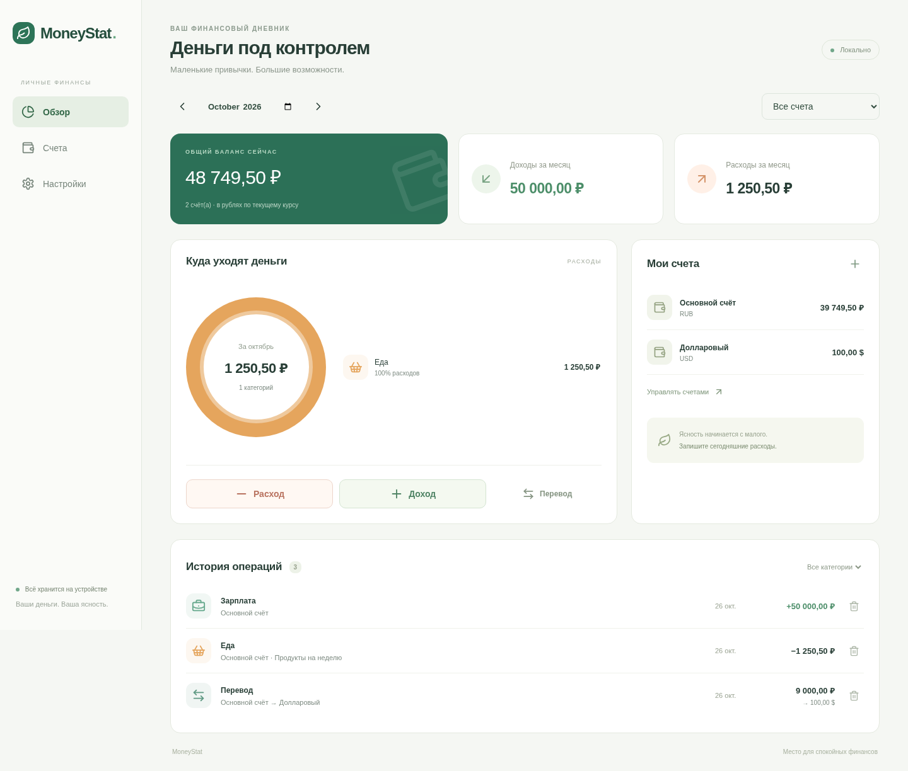
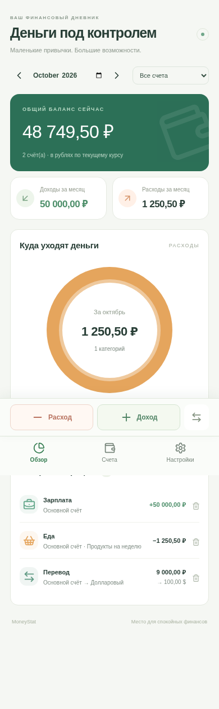

# MoneyStat

Локальный дневник личных финансов для Windows и Android. React + TypeScript, Electron (Windows), Capacitor (Android), IndexedDB через Dexie. Интерфейс на русском, адаптирован для телефона и рабочего стола; палитра и круговая диаграмма вдохновлены Monefy.



<details><summary>Интерфейс на телефоне</summary>



</details>

## Возможности

- Расходы и доходы: категория, счёт, дата, заметка; удаление ошибочной операции с пересчётом балансов.
- Предустановленные категории: еда, дом, ипотека, транспорт, здоровье, покупки, развлечения, связь, образование; зарплата, дивиденды, подарки. Свои категории с цветом и иконкой.
- Несколько счетов с валютой и начальным балансом (в том числе отрицательным). Валюту любого счёта можно изменить с подтверждением пересчёта его сумм.
- Переводы между счетами, в том числе разных валют. Сумма зачисления фиксируется отдельно, её можно скорректировать до сохранения. Переводы не входят в доходы и расходы.
- История за месяц или день, фильтр счёта/категории, диаграмма расходов, текущий баланс.
- Отдельная вкладка «Аналитика»: период, одна/несколько/все категории, гистограммы по дням/месяцам/годам, частота расходов и сравнение с месяцем/годом ранее или произвольным периодом. На «Обзор» — подсказки категорий с изменением относительно прошлого месяца.
- Ручные курсы и добавление валют по трёхбуквенному коду. Выбор валюты сводки выпадающим списком. USD=90 и EUR=100 — **условные начальные значения**, замените их своими в настройках.
- Визуальная галерея иконок и выбор цвета категорий; создание категории прямо в форме дохода/расхода.
- Опциональная интеграция с семейным Telegram-ботом: пошаговый ввод дохода/расхода и ручная загрузка очереди без дублей. Требует отдельного облачного сервера; настройка описана в [документе интеграции](docs/telegram-integration.md).
- Экспорт и восстановление JSON-копии. Android использует системное меню «Поделиться», Windows — загрузку файла.

Суммы хранятся целыми сотыми единицами валюты, до 10 млрд на счёт/операцию. Поддерживаются валюты с двумя десятичными знаками. Конвертация округляется до копейки. Аналитика использует **текущий** курс. Переключение валюты отображения не изменяет исходные суммы; подтверждённая смена валюты счёта пересчитывает их. Баланс сверху показывает все операции, фильтр дня/месяца относится к доходам, расходам, диаграмме и истории. Отрицательный баланс разрешён. Фильтр категории применяется только к истории.

Текущие требования, архитектура и подробное описание аналитики: [системный документ](docs/system-requirements.md).

Нет пользовательских аккаунтов, телеметрии, автоматических курсов и полной синхронизации устройств. Финансовая база находится в IndexedDB профиля приложения. Опциональный Telegram-сервер получает только справочник и очередь новых операций, но не существующую историю. Очистка данных приложения/профиля удалит локальную базу. JSON-копии не зашифрованы: храните их отдельно и безопасно. Восстановление JSON и импорт Monefy CSV заменяют текущую базу только после подтверждения и полной проверки; обычный CSV не используется как формат резервной копии, потому что не сохраняет надёжно связи и две стороны перевода.

## Разработка

Нужен Node.js 22 LTS и npm. Используйте существующий checkout; отдельный git worktree для облачной задачи не нужен.

```sh
npm ci
npm run dev
npm test
npm run build
npx playwright install chromium
npm run test:e2e
```

`npm test` проверяет денежные расчёты, переводы, проверки данных, сохранение, откат невалидной записи, восстановление и параллельные транзакции IndexedDB. E2E запускает полный сценарий для desktop и mobile размеров экрана. При наличии системного Chromium можно установить `CHROMIUM_PATH=/usr/bin/chromium`.

## Windows

На Windows 10/11 x64:

```sh
npm ci
npm run desktop
npm run dist:win
```

Установщик находится в `release/`. Он не подписан сертификатом; для публичного распространения потребуется подпись. База хранится в пользовательском профиле Electron (обычно `%APPDATA%/moneystat`). Не удаляйте профиль без резервной копии.

## Android

Нужны JDK 21, Android Studio / Android SDK с API 35. Минимальная версия Android — 6 (API 23), актуальный Android System WebView.

```sh
npm ci
npm run android:sync
npx cap open android
```

Запустите на эмуляторе/устройстве из Android Studio либо соберите APK:

```sh
cd android
./gradlew assembleDebug
```

Windows: `gradlew.bat assembleDebug`. APK: `android/app/build/outputs/apk/debug/app-debug.apk`. Это отладочная сборка, не релиз для Google Play. Для распространения потребуется собственный ключ подписи. После изменения интерфейса повторите `npm run android:sync`.

## Автоматические сборки

GitHub Actions (`.github/workflows/build.yml`) запускает unit/E2E тесты, затем Windows NSIS и Android debug APK. Результаты доступны в Artifacts соответствующего запуска. Добавление workflow не означает, что сборки уже прошли: проверьте результат запуска Actions.

## Структура

- `src/model.ts` — денежные расчёты и проверка целостности.
- `src/store.ts` — локальная БД; изменения одной транзакцией.
- `src/App.tsx`, `src/style.css` — интерфейс и адаптивная верстка.
- `electron/`, `android/` — платформенные оболочки.
- `tests/` — тесты модели, хранилища и пользовательских сценариев.

Первый запуск создаёт один пустой рублёвый счёт. Демонстрационные операции в реальную базу не добавляются. Редактирование сохранённых операций пока выполняется удалением и повторным вводом.
