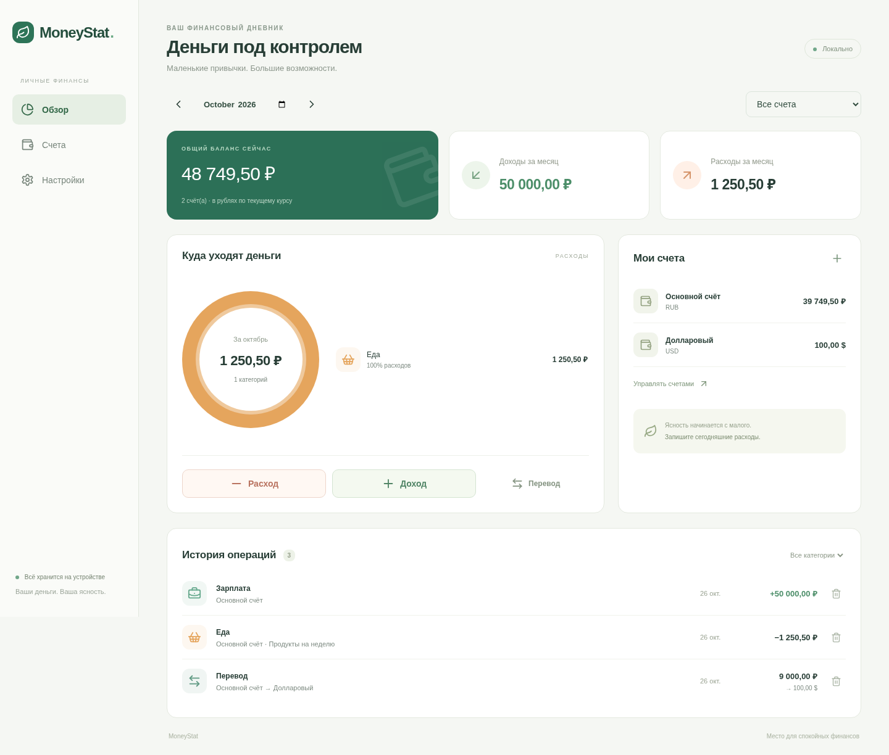
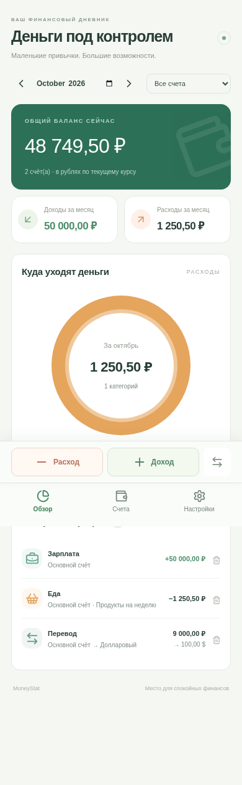

# MoneyStat

Локальный дневник личных финансов для Windows и Android. React + TypeScript, Electron (Windows), Capacitor (Android), IndexedDB через Dexie. Интерфейс на русском, адаптирован для телефона и рабочего стола; палитра и круговая диаграмма вдохновлены Monefy.



<details><summary>Интерфейс на телефоне</summary>



</details>

## Возможности

- Расходы и доходы: категория, счёт, дата, заметка; удаление ошибочной операции с пересчётом балансов.
- Предустановленные категории: еда, дом, ипотека, транспорт, здоровье, покупки, развлечения, связь, образование; зарплата, дивиденды, подарки. Свои категории с цветом и иконкой.
- Несколько счетов с неизменяемой валютой и начальным балансом (в том числе отрицательным).
- Переводы между счетами, в том числе разных валют. Сумма зачисления фиксируется отдельно, её можно скорректировать до сохранения. Переводы не входят в доходы и расходы.
- Помесячная история, фильтр счёта/категории, диаграмма расходов, текущий баланс.
- Ручные курсы и добавление валют по трёхбуквенному коду. Общая сводка в RUB. USD=90 и EUR=100 — **условные начальные значения**, замените их своими в настройках.
- Экспорт и восстановление JSON-копии. Android использует системное меню «Поделиться», Windows — загрузку файла.

Суммы хранятся целыми сотыми единицами валюты, до 10 млрд на счёт/операцию. Поддерживаются валюты с двумя десятичными знаками. Конвертация округляется до копейки. Аналитика, включая прошлые месяцы, использует **текущий** курс; суммы исходных операций не изменяются. Баланс сверху показывает все операции, фильтр месяца относится к доходам, расходам и истории. Отрицательный баланс разрешён. Фильтр категории применяется к истории, диаграмма всегда показывает все расходы месяца выбранного счёта.

Нет авторизации, сервера, телеметрии, автоматических курсов и синхронизации. Данные находятся в IndexedDB профиля приложения на конкретном устройстве. Очистка данных приложения/профиля удалит базу. Копии не зашифрованы: храните их отдельно и безопасно. Импорт заменяет текущую базу после подтверждения и полной проверки. CSV не используется: он не сохраняет надёжно связи между счетами, категориями и двумя сторонами перевода.

## Разработка

Нужен Node.js 22 LTS и npm. Используйте существующий checkout; отдельный git worktree для облачной задачи не нужен.

```sh
npm ci
npm run dev
npm test
npm run build
npx playwright install chromium
npm run test:e2e
```

`npm test` проверяет денежные расчёты, переводы, проверки данных, сохранение, откат невалидной записи, восстановление и параллельные транзакции IndexedDB. E2E запускает полный сценарий для desktop и mobile размеров экрана. При наличии системного Chromium можно установить `CHROMIUM_PATH=/usr/bin/chromium`.

## Windows

На Windows 10/11 x64:

```sh
npm ci
npm run desktop
npm run dist:win
```

Установщик находится в `release/`. Он не подписан сертификатом; для публичного распространения потребуется подпись. База хранится в пользовательском профиле Electron (обычно `%APPDATA%/moneystat`). Не удаляйте профиль без резервной копии.

## Android

Нужны JDK 21, Android Studio / Android SDK с API 35. Минимальная версия Android — 6 (API 23), актуальный Android System WebView.

```sh
npm ci
npm run android:sync
npx cap open android
```

Запустите на эмуляторе/устройстве из Android Studio либо соберите APK:

```sh
cd android
./gradlew assembleDebug
```

Windows: `gradlew.bat assembleDebug`. APK: `android/app/build/outputs/apk/debug/app-debug.apk`. Это отладочная сборка, не релиз для Google Play. Для распространения потребуется собственный ключ подписи. После изменения интерфейса повторите `npm run android:sync`.

## Автоматические сборки

GitHub Actions (`.github/workflows/build.yml`) запускает unit/E2E тесты, затем Windows NSIS и Android debug APK. Результаты доступны в Artifacts соответствующего запуска. Добавление workflow не означает, что сборки уже прошли: проверьте результат запуска Actions.

## Структура

- `src/model.ts` — денежные расчёты и проверка целостности.
- `src/store.ts` — локальная БД; изменения одной транзакцией.
- `src/App.tsx`, `src/style.css` — интерфейс и адаптивная верстка.
- `electron/`, `android/` — платформенные оболочки.
- `tests/` — тесты модели, хранилища и пользовательских сценариев.

Первый запуск создаёт один пустой рублёвый счёт. Демонстрационные операции в реальную базу не добавляются. Редактирование сохранённых операций пока выполняется удалением и повторным вводом.
