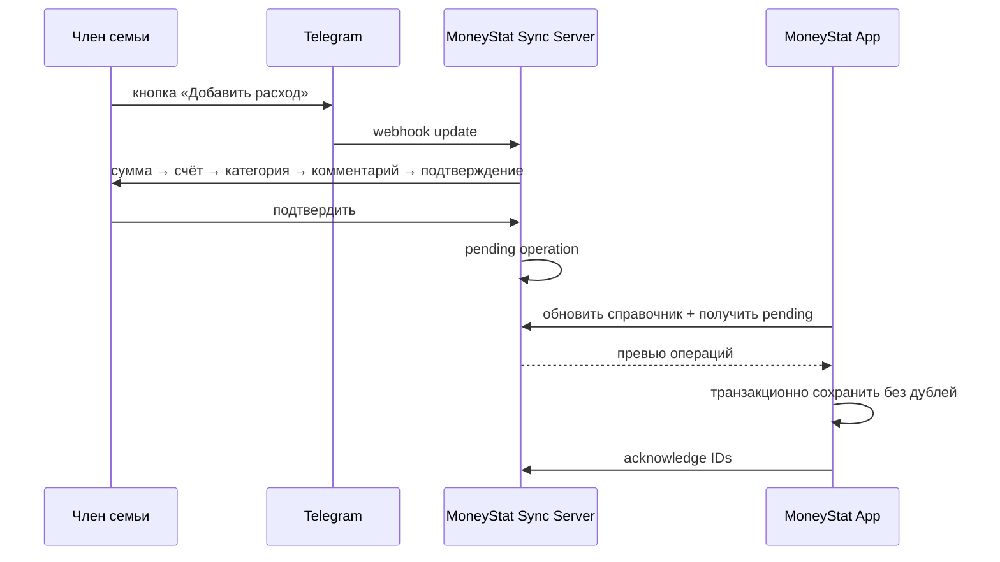

# Telegram-интеграция MoneyStat

Статус: MVP в разработке. Дата решения: 06.11.2026.

## Цель и выбранная схема

Члены семьи записывают доходы и расходы через приватный чат с Telegram-ботом. Бот сохраняет подтверждённые операции в облачной очереди. Основное приложение MoneyStat по кнопке «Подгрузить из Telegram» получает превью и после подтверждения добавляет операции в локальную IndexedDB.

Это **не полная синхронизация устройств**: сервер не получает историю MoneyStat и не изменяет локальную базу сам. Одно основное устройство забирает семейную очередь. Повторное получение одной записи безопасно и не создаёт дубль.

## Команды и кнопки бота

| Команда | Назначение |
| --- | --- |
| `/start` | Проверить доступ, показать меню и одноразовый код привязки приложения. |
| `/expense` | Начать добавление расхода. |
| `/income` | Начать добавление дохода. |
| `/cancel` | Отменить текущий незавершённый сценарий без создания операции. |
| `/status` | Показать количество ожидающих импорта операций пользователя/семьи. |
| `/help` | Краткая инструкция и объяснение, где операция появится. |

Постоянное меню содержит «➖ Добавить расход», «➕ Добавить доход», «📥 Ожидают импорта», «❌ Отмена». Основной сценарий:

1. Пользователь выбирает доход или расход.
2. Вводит положительную сумму с точностью до двух знаков.
3. Выбирает счёт кнопкой из справочника MoneyStat.
4. Выбирает категорию подходящего типа кнопкой.
5. Вводит комментарий или нажимает «Пропустить».
6. Проверяет сумму, счёт, категорию, дату и комментарий; нажимает «Сохранить» или «Отмена».
7. Дата MVP — текущая дата сервера в часовом поясе `Europe/Moscow`. Редактирование даты будет отдельным улучшением.

Незавершённый диалог не создаёт операцию. Новый `/expense` или `/income` заменяет старый незавершённый диалог после явного действия пользователя.

## Семейный доступ

- Один сервер соответствует одной семейной базе/очереди.
- В переменной окружения задаётся allowlist Telegram user ID членов семьи. Username не используется как идентификатор и может только отображаться.
- Бот работает только в приватных чатах. Сообщения посторонних пользователей и групп отклоняются.
- Справочник счетов и категорий приходит из одного основного приложения. Бот не создаёт категории и счета в MVP.
- Если справочник ещё не загружен, бот объясняет, что сначала нужно привязать MoneyStat.

## Привязка приложения

1. Развернуть сервер с PostgreSQL и HTTPS.
2. Создать бота через `@BotFather`, сохранить токен только в секретах сервера.
3. Член семьи из allowlist отправляет `/start`; сервер выдаёт одноразовый 8-значный код с коротким сроком жизни.
4. В MoneyStat открыть «Настройки → Telegram-бот», указать HTTPS-адрес сервера и код.
5. Сервер возвращает длинный токен устройства; приложение хранит его локально вне финансовой резервной копии.
6. Приложение передаёт серверу только ID/название/валюту счетов и ID/название/тип категорий.

Токен бота никогда не вводится в MoneyStat и не передаётся клиенту. Отключение на устройстве удаляет локальный токен, но не удаляет очередь сервера.

## API MVP

| Метод | Путь | Авторизация | Назначение |
| --- | --- | --- | --- |
| `POST` | `/v1/link` | одноразовый код | Выдать токен устройства. |
| `PUT` | `/v1/catalog` | Bearer device token | Заменить серверный справочник счетов/категорий. |
| `GET` | `/v1/entries/pending` | Bearer device token | Получить неприменённые операции. |
| `POST` | `/v1/entries/ack` | Bearer device token | Пометить успешно сохранённые ID применёнными. |
| `POST` | `/telegram/webhook` | Telegram secret header | Получить update Telegram. |
| `GET` | `/healthz` | нет | Проверка процесса и базы для хостинга. |

Суммы передаются целыми сотыми единицами. Серверные ID операций неизменны. MoneyStat хранит `externalId = telegram:<server-id>`; уже существующий `externalId` пропускается, после чего серверу всё равно отправляется подтверждение.

## Надёжность импорта

- Приложение показывает превью и запрашивает подтверждение перед локальной записью.
- Сначала операция транзакционно сохраняется в IndexedDB, затем сервер получает acknowledge.
- Если acknowledge не дошёл, следующая загрузка вернёт запись снова; `externalId` предотвращает дубль.
- Если счёт или категория были удалены/изменили тип, весь пакет отклоняется до обновления справочника; серверные записи не подтверждаются.
- Доходы и расходы проходят обычную `validate()` MoneyStat и сразу участвуют в балансе/аналитике. Telegram-переводы между счетами не входят в MVP; их следует создавать в приложении до отдельного согласованного flow.

## Безопасность и эксплуатация

- Только HTTPS, кроме локальной разработки на `localhost`.
- PostgreSQL с постоянным диском/managed backup; секреты только в переменных окружения.
- Webhook проверяет `X-Telegram-Bot-Api-Secret-Token`; Telegram update ID обрабатывается идемпотентно.
- Одноразовые коды и device tokens хранятся на сервере только в виде криптографических хэшей. Код короткоживущий и одноразовый.
- Ограничение размера JSON, базовый rate limit, CORS только для разрешённых origin.
- Сервер не логирует токены, комментарии или полные тела финансовых запросов.
- Очередь имеет политику хранения; для MVP подтверждённые записи можно хранить ограниченное время для диагностики, затем удалять.

Официальный Telegram Bot API допускает webhook или long polling; production-схема использует webhook с secret token: <https://core.telegram.org/bots/api>. Inline-кнопки передают `callback_data` и требуют ответа на callback query.

## Что нужно от владельца перед развёртыванием

1. Создать бота у `@BotFather` и получить token (не добавлять его в Git и не отправлять в чат).
2. Узнать Telegram user ID всех членов семьи и задать allowlist.
3. Создать российский VPS с Node.js/Docker, PostgreSQL и публичным HTTPS-доменом; выбран Timeweb Cloud.
4. Задать секреты сервера и применить SQL-миграцию.
5. Развернуть сервер, вызвать установку webhook и проверить `/health`.
6. Пересобрать/обновить MoneyStat, выполнить привязку кодом и проверить синтетическую операцию до реальных данных.

Для выбранного варианта с оплатой российской картой используйте пошаговый [runbook Timeweb Cloud VPS](telegram-timeweb.md). Docker Compose остаётся переносимым на другой VPS.

## Не входит в MVP

- Полная двусторонняя синхронизация финансовой истории и нескольких независимых устройств.
- Переводы между счетами через бота, создание/редактирование счетов и категорий, удаление уже импортированных операций.
- Свободный текст/ИИ-распознавание, чеки, голосовые сообщения и автоматические курсы.
- Публичная многопользовательская регистрация и несколько семей на одном deployment.
